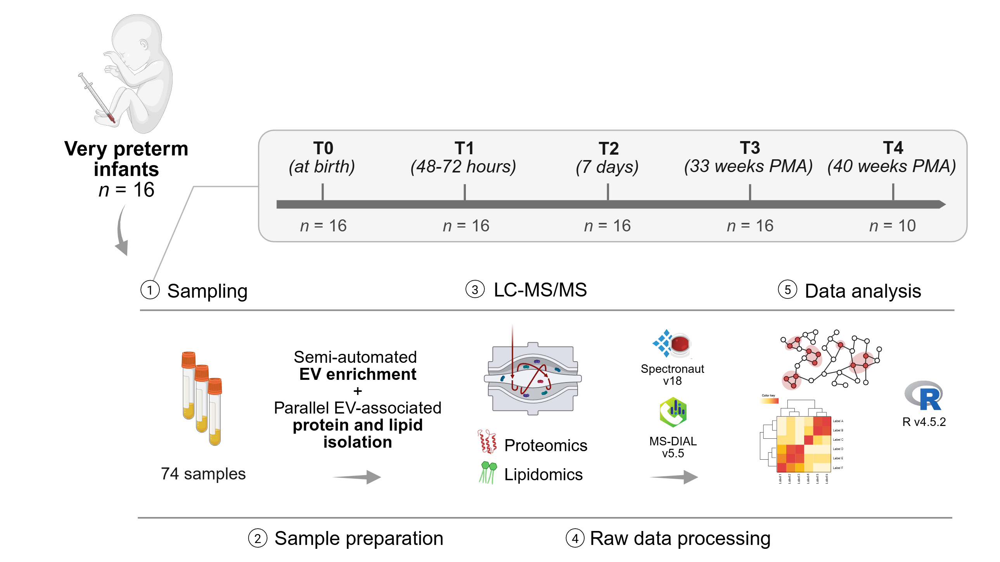

# Longitudinal plasma EV multi-omics in very preterm infants


<sub>Created with BioRender.com</sub>

R code accompanying:

> Grinovero N., Antonini F., *et al.* **Small volumes, deep insights: longitudinal plasma EV multi-omics in very preterm infants.** *medRxiv* (2026). https://doi.org/10.64898/2026.02.04.26345553  
> A revised version is currently under peer review.

The scripts cover the omics analyses: technical validation of the micro-volume Mag-Net workflow, the longitudinal proteomic and lipidomic analyses (preprocessing, linear mixed-effects models, clustering, enrichment), cross-omics network integration, module–outcome association testing (CAMERA), and the corresponding main and supplementary figures.

## Method

EVs are enriched from 10 µL of plasma with strong anion exchange (SAX) magnetic beads on a KingFisher Apex, adapting the Mag-Net workflow [1]. Proteins and lipids are then recovered in parallel from the same preparation: a monophasic BuOH/ACN/H₂O (3:1:1) extraction, based on the BAMM approach [2], lyses the captured EVs, proteins are processed by on-bead protein aggregation capture (PAC) and digestion, and the lipid-containing supernatant is collected and dried. Peptides are analyzed by data-independent acquisition and processed in Spectronaut; lipids are analyzed by reversed-phase (C18) LC-MS/MS in data-dependent acquisition and processed in MS-DIAL and MS-FLO.

1. Wu, C. C. *et al.* Enrichment of extracellular vesicles using Mag-Net for the analysis of the plasma proteome. *Nat. Commun.* **16**, 5447 (2025). https://doi.org/10.1038/s41467-025-60595-7
2. Muehlbauer, L. K. *et al.* Rapid multi-omics sample preparation for mass spectrometry. *Anal. Chem.* **95**, 659–667 (2023). https://doi.org/10.1021/acs.analchem.2c02042

## Repository structure

```
scripts/
├── 01_technical_validation/   technical replicates (pooled adult plasma): lipid cleaning
├── 02_proteomics/             cohort: cleaning, normalization, imputation, LMM, clustering, enrichment
├── 03_lipidomics/             cohort: cleaning, normalization, imputation, LMM, clustering
├── 04_integration/            protein–lipid network, module annotation, module–outcome CAMERA
└── 05_figures/                one script per figure (Fig. 1, 3–7; Fig. S1, S2, S6–S8)
data/                          technical-validation proteomics, annotation and reference files (other inputs: see Input files)
assets/                        image used in this README
```

All paths are resolved with [`here`](https://here.r-lib.org/) relative to the project root (`preterm-ev-multiomics.Rproj`). Scripts are run one at a time from the project root, in the order below.

## Data availability

- **Proteomics and lipidomics**: mass spectrometry data are deposited in ProteomeXchange via PRIDE, dataset **PXD074778**.
- **Clinical metadata**: not included in this repository; available from the corresponding author upon request.
- **Technical-validation proteomics** (Spectronaut exports of the pooled adult plasma replicates), **annotation and reference files** (sample annotation of the technical replicates, EV reference panels, MISEV2023 category assignment) are included in `data/`.

## Input files

Paths are relative to the project root; `outputs/` is created by the scripts. Source: **PRIDE** = dataset PXD074778; **repo** = included in this repository; **request** = available from the corresponding author.

### Longitudinal cohort

| Path | Description | Source |
|---|---|---|
| `data/proteomics/raw/20251106_112203_Andreato_Plasma_Prematuri_MagNet_Report.tsv` | Spectronaut report (protein group quantities, exported on log2 scale) | PRIDE |
| `data/lipidomics/raw/Area_1_2025_12_17_16_14_21.txt` | MS-DIAL area table (before MS-FLO) | PRIDE |
| `data/lipidomics/raw/Area_1_2025_12_17_16_14_21_processed.txt` | MS-FLO processed area table | PRIDE |
| `data/metadata/sample_metadata.txt` | sample and clinical metadata, one row per sample (columns below) | request |
| `outputs/tables/preterm/lipidomics/LION-enrichment-report-T4-vs-T0/LION_enrichment_ranking_beta_T4_vs_T0.csv` | LION/web report, lipids ranked by T4 vs T0 β (see *Steps performed outside R*) | generated |

#### Metadata columns

| Column | Content |
|---|---|
| `sample_id` | sample identifier used as column name in the processed tables |
| `lipidomics_raw_id`, `proteomics_raw_id` | sample names in the MS-DIAL and Spectronaut exports |
| `patient_id` | pseudonymized infant identifier (random effect / blocking factor) |
| `timepoint` | T0–T4 |
| `ga_birth` | gestational age at birth (weeks) |
| `sex` | F / M |
| `birth_weight` | g |
| `any_brain_lesion`, `hemorrhagic_lesion`, `white_matter_lesion`, `sepsis`, `mechanical_ventilation` | binary clinical outcomes (0/1) |

### Technical validation (pooled adult plasma)

| Path | Description | Source |
|---|---|---|
| `data/techrep/proteomics/20260206_182115_plasma_EV_multiomics_techrep_Report.tsv` | Spectronaut report | repo |
| `data/techrep/proteomics/plasma_EV_multiomics_techrep_IdentificationsOverview.tsv` | Spectronaut identifications overview | repo |
| `data/techrep/lipidomics/C18_pos/Area_plasma_EV_multiomics_techrep_C18_pos.txt` | MS-DIAL area table, positive mode | PRIDE |
| `data/techrep/lipidomics/C18_pos/Area_plasma_EV_multiomics_techrep_C18_pos_MSFLO_processed.txt` | MS-FLO processed, positive mode | PRIDE |
| `data/techrep/lipidomics/C18_neg/Area_plasma_EV_multiomics_techrep_C18_neg.txt` | MS-DIAL area table, negative mode | PRIDE |
| `data/techrep/lipidomics/C18_neg/Area_plasma_EV_multiomics_techrep_C18_neg_MSFLO_processed.txt` | MS-FLO processed, negative mode | PRIDE |
| `data/techrep/lipidomics/sample_meta_C18_pos.txt`, `sample_meta_C18_neg.txt` | sample annotation (condition, replicate) | repo |

### Reference panels (from Rai *et al.*, *Nat. Cell Biol.* 2025, doi:10.1038/s41556-025-01795-7)

| Path | Description | Source |
|---|---|---|
| `data/reference/evmap2025_conservedEV_proteins_182.txt` | the 182 conserved circulating EV proteins (gene name, marker type) | repo |
| `data/reference/MAP_reference_to_MSDIAL_POS.tsv`, `MAP_reference_to_MSDIAL_NEG.tsv` | conserved EV lipid features mapped to MS-DIAL annotations | repo |

### MISEV2023 categories (Welsh *et al.*, *J. Extracell. Vesicles* 2024, Table 3)

| Path | Description | Source |
|---|---|---|
| `data/reference/misev2023_category_assignment.tsv` | gene-to-category assignment used in Fig. S6 | repo |

## Run order

### 1. Technical validation (`scripts/01_technical_validation/`)

| Script | Input | Output |
|---|---|---|
| `01_techrep_lip_cleaning.R` | MS-DIAL / MS-FLO tables, C18 POS and NEG | `data/techrep/lipidomics/processed/` |

### 2. Longitudinal cohort

| Step | Script | Output |
|---|---|---|
| Proteomics | `02_proteomics/01_prot_cleaning.R` | `data/proteomics/processed/proteins_cleaned.txt` |
| | `02_proteomics/02_prot_norm_impute.R` | `proteins_filtered.txt`, `proteins_norm_imputed.txt` |
| | `02_proteomics/03_prot_enrich_compartments.R` | Jensen COMPARTMENTS enrichment (Enrichr) |
| | `02_proteomics/04_prot_stats_time_LMM.R` | `outputs/tables/preterm/proteomics/proteins_LMM_time_results.txt` |
| | `02_proteomics/05_prot_clustering_time_trajectories.R` | temporal clusters |
| | `02_proteomics/06_prot_enrich_T4vsT0_GOBP_Reactome.R` | GO BP / Reactome enrichment, T4 vs T0 |
| Lipidomics | `03_lipidomics/01_lip_cleaning.R` | `data/lipidomics/processed/lipids_cleaned.txt` |
| | `03_lipidomics/02_lip_norm_impute.R` | `lipids_norm_imputed.txt` |
| | `03_lipidomics/03_lip_stats_time_LMM.R` | `outputs/tables/preterm/lipidomics/lipids_LMM_time_results.txt` |
| | `03_lipidomics/04_lip_clustering_time_trajectories.R` | temporal clusters |
| Integration | `04_integration/01_integrate_prot_lip_network.R` | correlation network, Louvain modules |
| | `04_integration/02_integrate_module_interpretation_GOBP.R` | module GO BP enrichment |
| | `04_integration/03_modules_camera_all_outcomes_multiomics.R` | module–outcome CAMERA tests (default and estimated inter-feature correlation), group sizes, leading-edge features |

### 3. Figures (`scripts/05_figures/`)

Each figure script reads the outputs of the steps above (or, for Fig. 1, S1 and S2, the technical-validation inputs directly) and writes to `outputs/figures/`.

| Script | Figure |
|---|---|
| `fig1_method_validation.R` | Fig. 1a–c, e, f; Fig. S2c |
| `fig1d_figS2d_ev_signature.R` | Fig. 1d; Fig. S2d |
| `fig3_dataset_overview.R` | Fig. 3 |
| `fig4_proteome_remodeling.R` | Fig. 4 |
| `fig5_lipidome_remodeling.R` | Fig. 5 |
| `fig6_crossomics_integration.R` | Fig. 6b–d |
| `fig7a_clinical_associations.R` | Fig. 7a |
| `fig7bcd_candidate_profiles.R` | Fig. 7b–d |
| `figS1_proteomics_correlation_overlap.R` | Fig. S1 |
| `figS2ab_lipidomics_depth.R` | Fig. S2a, b |
| `figS6_rankplot_neat_vs_enriched.R` | Fig. S6 |
| `figS7_quantification_depth.R` | Fig. S7 |
| `figS8_membrane_endosomal_proteins.R` | Fig. S8 |

EV characterization (NTA, TEM, imaging flow cytometry, western blot; Fig. 2 and Fig. S3–S5) and schematic panels are not generated by these scripts.

### 4. Supplementary Tables

| Table | Produced by |
|---|---|
| S1 | `02_proteomics/03_prot_enrich_compartments.R` (`enrich_Jensen_COMPARTMENTS_all.txt`) |
| S2 | `02_proteomics/04_prot_stats_time_LMM.R` |
| S3 | `02_proteomics/06_prot_enrich_T4vsT0_GOBP_Reactome.R` |
| S4 | `03_lipidomics/03_lip_stats_time_LMM.R` |
| S5 | `04_integration/03_modules_camera_all_outcomes_multiomics.R` (`modules_camera_all_outcomes_multiomics.tsv`) |
| S6 | same script (`drivers_top2_<layer>_<outcome>.tsv`) |
| S7 | same script (`effects_<layer>_<outcome>.tsv`) |
| S8 | per-timepoint Mann-Whitney comparisons, not included in this repository |

## Steps performed outside R

- **Spectronaut v18** (Biognosys): DIA data processing; the scripts start from the Spectronaut report exports. The cohort report contains log2-transformed protein group quantities, used as such (no further log transformation); the technical-validation report contains linear quantities.
- **MS-DIAL v5.5 / MS-FLO v1.8**: lipid feature detection, annotation and deduplication; the scripts start from the exported area tables.
- **Enrichr** (via the `enrichR` package, `03_prot_enrich_compartments.R`): queries the Enrichr web service, so it needs an internet connection and results depend on the library version online at the time of the query.
- **LION/web**: lipid ontology enrichment, run on lipids ranked by the T4 vs T0 β coefficient from `lipids_LMM_time_results.txt`. The exported report is read by `fig5_lipidome_remodeling.R` (see *Input files*).

## Software

Analyses were run in R 4.5.2. Required packages can be installed with:

```r
install.packages(c(
  "tidyverse", "here", "scales", "patchwork", "cowplot", "ggrepel", "ggridges",
  "ggnewscale", "svglite", "ragg", "gt", "igraph", "cluster", "lmerTest", "imp4p",
  "enrichR", "ComplexUpset", "circlize", "BiocManager", "remotes"
))
BiocManager::install(c(
  "limma", "clusterProfiler", "ReactomePA", "org.Hs.eg.db", "AnnotationDbi",
  "ComplexHeatmap", "rgoslin"
))
remotes::install_github("BioinfOMICS/LipidSigR")
```

Random seeds are set in the scripts that use stochastic steps (imputation, clustering, layout).

## Citation

If you use this code, please cite:

> Grinovero N., Antonini F., *et al.* Small volumes, deep insights: longitudinal plasma EV multi-omics in very preterm infants. *medRxiv* (2026). https://doi.org/10.64898/2026.02.04.26345553

## License

Code released under the MIT License (see `LICENSE`).
